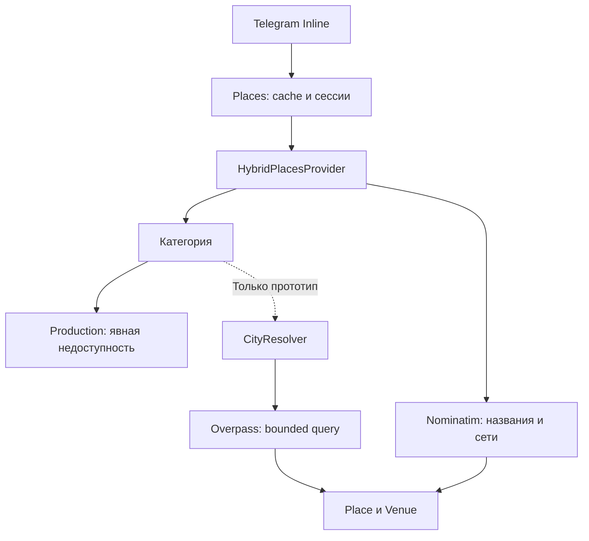

# Гибридный поиск: прототип, 8 ноября 2026

## Решение и статус

Предварительная проверка Overpass не пройдена. Production-подключение **отключено**: index.ts создаёт HybridPlacesProvider без экспериментальных зависимостей. Категории возвращают CATEGORY_UNAVAILABLE с переходом в личный чат. Никакие моки не возвращаются пользователям. Конкретные названия и сети продолжают использовать Nominatim. Не заявляется поиск всех организаций города.

Исходная main: ae2cbe3b66b74effaecf3bec29a18b0089351f01. Изучен пользовательский kuda-poyti-search-audit.md. Рабочая ветка feature/hybrid-place-search; VPS, SSH, production-токен, polling и развёртывание не использовались.

## Фактические сетевые проверки

Запросы выполнялись последовательно, однократно, из среды разработки. Один endpoint, без повторов и зеркал. Таймаут клиента 10 секунд, предел ответа 1 МБ.

| Проверка | HTTP | Задержка | Результат |
|---|---|---|---|
| GET https://overpass-api.de/api/status | 406 | 5,450622 с | Endpoint не подтвердил доступность |
| POST https://overpass-api.de/api/interpreter | 406 | 4,903116 с | HTML nginx, валидный OSM JSON не получен |

Ограниченный запрос кафе:

```overpass
[out:json][timeout:5][maxsize:16777216];
nwr[amenity=cafe](51.65,39.19,51.67,39.22);
out center qt 10;
```

Источник HTTP 406 (сервис или промежуточная инфраструктура) не установлен. Это не подтверждает глобальную недоступность сервиса, отсутствие кафе или скорость с VPS. После отказа дальнейшие live-запросы не выполнялись. Граница Воронежа, рестораны, продуктовые, реальные поля и area не подтверждены. 429, 504, remark и прерывание проверены только моками. Успешная задержка не измерена.

## Архитектура



CityResolver принимает только RU administrative relation с совпавшим именем и addresstype населённого пункта. Поддерживает «город, регион»; несколько подходящих relation требуют уточнения. Результат предельной длины тоже считается неоднозначным. Без relation/area радиус не подставляется. Результаты Nominatim могут быть неполными: исчерпывающая проверка омонимов и точного соответствия городских/муниципальных границ остаётся задачей live-валидации. При будущей сборке прототипа CityResolver должен использовать lookup того же экземпляра Nominatim, чтобы сохранить общий лимит.

Overpass использует фиксированные теги, проверенный числовой relation ID, map_to_area и проверку наличия соответствующей area в ответе. Node → lat/lon; way/relation → center. Center не гарантирует вход или положение внутри полигона. name:ru/name/brand:ru/brand, затем категория. Адрес из addr:full или компонентов; без адреса это явно указано. Reverse geocoding отсутствует. Дедупликация по OSM type/id, филиалы не объединяются по бренду.

## Пределы и пагинация

Overpass QL не предоставляет здесь серверную пагинацию. Прототип запрашивает максимум 101 объект как контрольную выборку, возвращает до 100 после валидации, сортирует по стабильному OSM ID. Это **ограниченная выборка**, не ближайшие, лучшие или все организации. Полнота не гарантируется даже при количестве меньше лимита: отсутствующие теги, некорректные координаты, покрытие OSM. Лимит out ограничивает ответ, но не стоимость поиска внутри большой area; не включать для Москвы без оценки времени и ресурсов.

Telegram получает по 10 Venue. Offset — случайный 96-битный session ID и номер страницы, привязанные к нормализованному запросу. Некорректный/истёкший offset не вызывает внешнего запроса. Повтор страницы возвращает тот же порядок. В конце next_offset пустой. Сессии: 5 минут, 50 записей, 4 МБ. Кэш результатов: 100 записей, 4 МБ, успешные 24 часа, пустые 10 минут. Города: 100 записей, 4 МБ, 7 дней. Ограничения по объёму относятся к сериализованным данным, а не точному heap V8; общий расход памяти включает накладные расходы Map и объектов. Pending-запросы ограничены 10 ключами, одинаковые объединяются.

Один общий AbortSignal на 9 секунд для пользовательского поиска; в MVP выполняется только Nominatim с дополнительным пределом 6 секунд; в мок-прототипе разрешение города и Overpass выполняются последовательно, без retry/fallback. На каждый адаптер один активный запрос, лимит старта и cooldown после 429/5xx, Retry-After. Тела ответов ограничены 1 МБ. Ошибки не кэшируются как EMPTY. Состояния SearchError и сообщения в личном чате отличаются; ошибок в фиктивных Venue нет. Успех представлен массивом Place, пустой успех отображается как EMPTY.

## Условия публичных API

Проверены 8 ноября 2026:

- https://operations.osmfoundation.org/policies/nominatim/ — максимум 1 запрос/с суммарно на приложение, идентификация, атрибуция, отсутствие autocomplete и систематической выгрузки POI. Символ ! сохранён; оператор осознанно выбирает сервис и отвечает за соблюдение политики. При редактировании удалять ! до завершения нового ввода.
- https://dev.overpass-api.de/overpass-doc/en/preface/commons.html — общие слоты и cooldown, возможны 429/504. Общественный endpoint не является гарантированным backend для пользовательского приложения. Ориентиры нагрузки не являются SLA или разрешением на массовые выгрузки.

Для полного охвата большого города предложены лицензированный поставщик POI либо собственный индекс регионального OSM extract; это не реализовано, инфраструктура не добавлена.

## Верификация и оставшиеся задачи

Node.js 24.22.1. npm ci, npm run build, npm test выполняются локально. Docker CLI отсутствует: docker compose config и docker compose build попытались выполнить с тестовыми переменными, обе команды завершились command not found. Docker-сборка не подтверждена.

Перед включением категорий:

1. Успешно проверить endpoint, условия оператора, соответствие relation городской границе и наличие area, cafe/restaurant/grocery последовательно малыми запросами.
2. Измерить холодный и тёплый поиск в общем бюджете; оценить стоимость запроса для крупных городов. При непригодности оставить отключённым.
3. Проверить адреса, географию и реальные node/way/relation. Оценить неоднозначность городов и муниципальных границ.
4. Только после этого подключить адаптер и конфигурацию; провести Docker и ручную Telegram-проверку с отдельно разрешённым тестовым токеном.
5. Для полного охвата выбрать другой способ доступа к данным; текущий публичный прототип этого не обеспечивает.

Текущий MVP поддерживает названия и сети через Nominatim, но не полноценный поиск категорий. Сетевые и ручные Telegram-проверки в этой доработке не выполнялись. VPS не использовался. PR не сливается.

## Доработка MVP без Overpass

Маршрутизатор зависит от абстракции `CategoryPlacesProvider`, без импорта Overpass или его QL. Экспериментальный адаптер не подключён в точке запуска. Флагов окружения для включения нет: для будущего подключения потребуется изменение кода и отдельная верификация. Примеры композиции с CityResolver/Overpass находятся только в мок-тестах. Названия и сети: одна выборка Nominatim до 40 результатов, страницы по 10; порядок провайдера сохраняется без обещания лучшего первого результата. Сервис проверяет обязательные поля Place и координаты до выдачи Venue. Истёкшие/некорректные offsets имеют отдельное состояние INVALID_OFFSET.

Диагностика HTTP 406 не продолжалась: точная причина неизвестна, в сетевом пути наблюдался Envoy. Экспериментальный адаптер не задаёт идентифицирующий User-Agent (наблюдался стандартный `node`); до интеграции необходимо:

1. Добавить идентифицирующий User-Agent согласно требованиям оператора.
2. Уточнить причину HTTP 406 без обхода блокировок.
3. Подтвердить доступность выбранного endpoint.
4. Валидировать административные границы и area.
5. Измерить задержки и стоимость запросов.
6. Определить стратегию полного охвата города.
7. Спроектировать безопасную пагинацию больших выборок.

Дополнительная БД или инфраструктура в MVP не добавлена. Кэши очищают истёкшие записи при чтении и вставке, а объём ограничен даже при простое. Новые тесты используют только моки; публичные API не вызываются.
